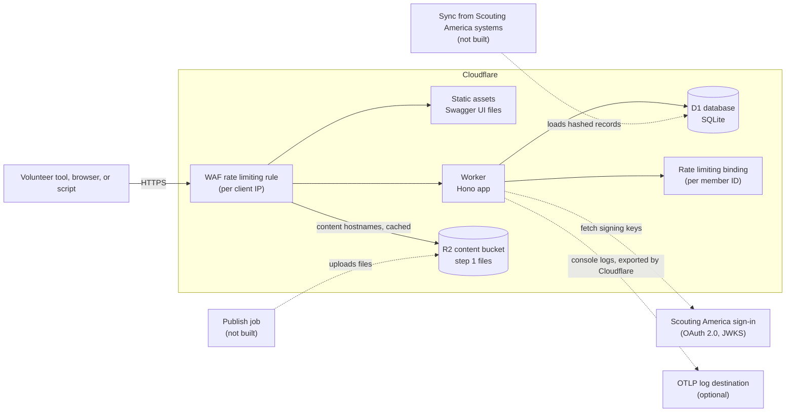
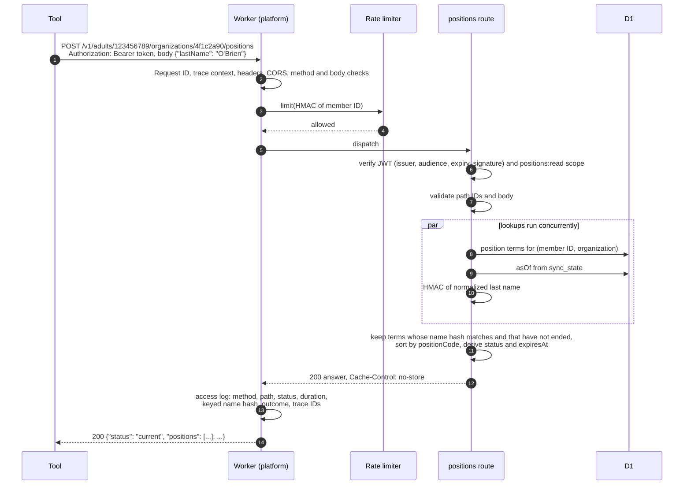
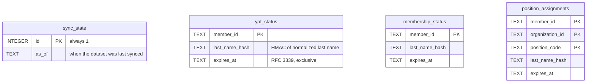

# Architecture

This document explains how the Scouting API proof of concept works. It is for developers who change the code
and for reviewers who must understand the design. It tells you what runs where, how the API handles a
request, how it stores data, and where to make changes.

This document does not explain why the team made each decision. For the reasons, see the
[architecture decision records (ADRs)](adr/README.md). The contract is in
[`openapi/openapi.json`](../openapi/openapi.json). The rules for all APIs are in the
[API guidelines](api-guidelines.md).

## What the system does

The API answers three questions about one adult. Each check identifies the adult by the member ID and the last
name together. The table gives each check:

| Question                                                                      | Endpoint                                                                      | Access    | Module       |
| ----------------------------------------------------------------------------- | ----------------------------------------------------------------------------- | --------- | ------------ |
| Does this adult have current Youth Protection Training (YPT), and until when? | `POST /v1/adults/{scoutingMemberId}/ypt`                                      | Open      | `ypt`        |
| Is this adult currently registered, and until when?                           | `POST /v1/adults/{scoutingMemberId}/membership`                               | Open      | `membership` |
| Which positions does this adult hold in this organization, and until when?    | `POST /v1/adults/{scoutingMemberId}/organizations/{organizationId}/positions` | Signed in | `positions`  |

Each check sends `{ "lastName": "..." }` in a JSON body. Each valid request gets the status code `200` and a
`status` of `current` or `notCurrent`. The cause of a `notCurrent` answer does not change the answer. This is
the uniform answer rule (see [ADR 0006](adr/0006-adult-check-contract.md)). The platform stores only the fields
that these answers need, and it stores only adults.

## System context

The API runs on Cloudflare. A request goes through the Cloudflare WAF (web application firewall) rate limiting
rule first. Requests for the documentation files go to the static assets. Requests to a content hostname go to the R2 content bucket, through the CDN cache. All other requests go to the Worker.

The Worker uses a rate limiting binding and a D1 database. It gets signing keys from the sign-in service, and
Cloudflare can export its logs. A sync, which is not built, loads the data. The following diagram shows these
parts:



The parts have these functions:

- **Cloudflare Workers** runs the API as one Worker. The Worker does not use servers. It costs nothing when no
  requests come in, and it scales with demand (see [ADR 0001](adr/0001-hosting-cloudflare-workers-d1.md)).
- **Static assets** send the Swagger UI files. Cloudflare sends these files without the Worker.
- **D1** is the serverless SQLite database of Cloudflare. Each environment has its own database.
- **The rate limiting binding** counts checks for each member ID.
- **The R2 content bucket** holds the step 1 files: public program content and the reference files that the
  API uses. Readers get the files only through the CDN, at one hostname for each environment. The CDN keeps
  each file for one day and keeps ETags, so a client with the current version gets `304 Not Modified` (see
  [ADR 0013](adr/0013-r2-content-behind-the-cdn.md)).
- **The publish job** uploads the step 1 files to the bucket. It is not in this repository.
- **The sign-in service** of Scouting America supplies the keys that verify sign-in tokens (JSON Web Key Set,
  JWKS).
- **The OTLP destination** receives the logs. OTLP is the OpenTelemetry protocol. This destination is optional.
- **The sync** is not in this repository. It loads records from the systems of Scouting America, for example
  ScoutConnect. On your computer, a seed script does this work.

## Repository layout

The repository has these folders:

```text
apps/api/                  The Worker
  src/index.ts             Entry point: createApp(modules)
  src/env.ts               Bindings and request variables
  src/platform/            The shared contract and the behavior that all modules use
  src/modules/<check>/     One folder for each check: routes, data access, schemas, tests
  src/modules/index.ts     The list of registered modules
  migrations/              The D1 schema, applied in order
  public/docs/             Static assets: the Swagger UI start file, and Swagger UI files copied at build time
  scripts/                 Local secrets, sign-in tokens, seed data, OpenAPI export, Swagger UI copy
  test/                    The shared test tools and the test suites for all modules
apps/web/                  The sample frontend (Vite, no framework)
packages/api-client/       The TypeScript client, generated from the contract
openapi/openapi.json       The contract. A script generates it. Do not edit it by hand.
infra/tofu/                OpenTofu configuration: D1 databases, R2 content buckets, CDN cache rule. The state is in AWS S3.
docs/                      This document, the ADRs, the guidelines, and the assumptions
```

## Code structure

### Platform and modules

The Worker has two layers: the **platform** and the **feature modules**. A module uses only the platform. It
does not use a different module. ESLint enforces this boundary. To add a check, add one folder and one line in
the module list (see [ADR 0004](adr/0004-feature-modules.md)).

The platform has these files:

| Platform file    | Function                                                                                                                                            |
| ---------------- | --------------------------------------------------------------------------------------------------------------------------------------------------- |
| `app.ts`         | Builds the app: middleware, module routes, `/health`, `/openapi.json`, `/docs`, and error handling                                                  |
| `module.ts`      | Defines the `FeatureModule` contract (tag, base path, router), and a router with validation error handling                                          |
| `adult-check.ts` | Defines the check contract: identifier and body schemas, last name normalization, keyed hashes, the uniform answer rule (`evaluate`), and `respond` |
| `auth.ts`        | Defines `requireSignIn(scope)`, which verifies sign-in tokens with the keys of the identity provider                                                |
| `telemetry.ts`   | Implements W3C Trace Context and logs in the OpenTelemetry format                                                                                   |
| `openapi.ts`     | Defines the shared OpenAPI parts: the status code table, the problem schema, open enums, timestamps, examples, and the OAuth scheme                 |
| `problem.ts`     | Sends RFC 9457 problem responses, and gives each validation error a problem type                                                                    |

Each module has the same files:

| Module file       | Content                                                                         |
| ----------------- | ------------------------------------------------------------------------------- |
| `index.ts`        | The `FeatureModule` of the module: its OpenAPI tag and its router               |
| `routes.ts`       | The route definition (`createRoute`) and the handler, built from platform parts |
| `repository.ts`   | An interface and its D1 implementation. Replace this file to use other storage. |
| `schemas.ts`      | Response schemas in addition to the shared schema (positions only)              |
| `<check>.test.ts` | The tests of the module, at the HTTP seam                                       |

### One schema for code and contract

The routes use `@hono/zod-openapi`. One Zod schema does three things:

- It validates the request when the API runs.
- It gives the types for the handler.
- It describes the operation in OpenAPI.

Thus the code and the published contract always agree. The table gives each output of the schema and what
checks it:

| Output                             | Made by                                           | Checked by                                                |
| ---------------------------------- | ------------------------------------------------- | --------------------------------------------------------- |
| Request validation                 | Zod schemas in routes                             | HTTP tests                                                |
| `/openapi.json` (served)           | The app, when it runs                             | Contract tests                                            |
| `openapi/openapi.json` (committed) | `npm run generate`                                | A test fails if it is different from the served contract  |
| `packages/api-client` types        | `openapi-typescript`, from the committed contract | Client type tests. CI fails if the types are out of date. |
| Breaking change gate               | `oasdiff`, compared with the base branch          | CI, on each pull request                                  |
| Lint of the API rules              | Redocly custom rules in `redocly.yaml`            | `npm run lint`                                            |

## How the API handles a request

The middleware runs in this order for each request. Steps 1 to 5 apply to all requests. Steps 6 and 7 apply
only to `/v1`.

| Order | Step                                 | Result                                                                                                           |
| ----- | ------------------------------------ | ---------------------------------------------------------------------------------------------------------------- |
| 1     | Request ID                           | Reads `X-Request-Id`, or creates it                                                                              |
| 2     | Telemetry                            | Continues a valid `traceparent` from the caller, or starts a new trace. Writes one log record for each response. |
| 3     | Security headers                     | Adds HSTS, `nosniff`, `Cross-Origin-Resource-Policy: cross-origin`, and other headers                            |
| 4     | CORS                                 | Allows any origin, without credentials. Browsers keep the preflight result for one day.                          |
| 5     | Method check                         | Allows `POST` and `OPTIONS` on `/v1`, and `GET` and `OPTIONS` on other paths. Other methods get `405`.           |
| 6     | Body checks (`/v1`)                  | Requires JSON (`415`), a maximum of 1 KiB (`413`), and valid JSON (`400`)                                        |
| 7     | Member rate limit (`/v1/adults/...`) | Allows about 10 checks each minute for each member ID, from all callers (`429`)                                  |
| 8     | Route                                | Verifies the sign-in (positions only), then validates the request, then runs the handler                         |

The following diagram shows a signed-in positions check. The tool sends the request. The platform does steps 1
to 7. The route verifies the token, validates the request, and reads the data. Then it filters the position
terms and sends the answer. The platform writes the log record.



The open checks use the same steps without the sign-in. They read one record instead of a list.

### Answers and errors

The API makes answers and errors with these rules:

- **The uniform answer rule.** For the checks that read one record, `evaluate()` gives `current` only when
  these three conditions are true:
  - The record exists.
  - The stored name hash is equal to the hash of the supplied name.
  - The record has not expired.

  All other cases give the same `notCurrent` answer, with the same bytes. Thus
  the answer does not show which part failed. For positions, the API calculates `status` from the filtered list,
  so `status` and the list always agree.

- **`asOf`.** This value is the same in each answer, for the full dataset. Thus it does not show if an ID is
  real.
- **Errors.** Errors use RFC 9457 `application/problem+json`, with problem types in camelCase, for example
  `invalidMemberId`, `invalidLastName`, `unsupportedMediaType`, and `rateLimited`. Each request field that fails
  validation has its own problem type. An unexpected error gets `500`. The log of that error does not contain
  the URL or the body.
- **No cache.** Answers have `Cache-Control: no-store` (see [ADR 0010](adr/0010-post-for-checks-no-caching.md)).

## Data model

The database has four tables. The table `sync_state` has one row with `as_of`, the time of the last sync. The
tables `ypt_status` and `membership_status` have one row for each adult, keyed by `member_id`. The table
`position_assignments` has one row for each position term, keyed by `member_id`, `organization_id`, and
`position_code`. Each check table has `last_name_hash` and `expires_at`. The following diagram shows the
columns:



The tables do not have relationships, and there is no shared table of adults. These rules apply:

- **Each module owns its table.** A check reads only its own table. Thus a new or removed check does not change
  the data of a different check. Each table can get its data from a different source system.
- **A table contains only the data that its answer needs.** The tables do not contain names, dates of birth,
  contact details, completion dates, or history. The tables do not contain youth, so a youth member ID has no
  row.
- **The table stores the last name only as a keyed hash.** `last_name_hash` is an HMAC-SHA256 of the normalized
  last name, with the key `NAME_HASH_KEY`. The sync must use the same normalization rules and the same key.
- **`position_assignments` has no index by member ID only.** Its primary key starts with
  `(member_id, organization_id)`. This agrees with the only question that the API answers. You cannot ask where
  an adult serves.
- **The tables keep expired rows.** The API filters them when it reads. `expires_at` is the first time when the
  answer is not true. The sync must remove old rows.

### Last name normalization

The API normalizes the supplied name and the source name with `normalizeLastName` before it hashes them. These
are the steps:

1. Remove accents (`Peña` becomes `pena`).
2. Change all letters to lowercase.
3. Remove one generational suffix at the end (Jr, Sr, II, III, IV), if other words remain.
4. Remove all characters that are not letters or digits.

Thus `O'Brien`, `OBrien`, and `obrien` give the same hash.

### Keyed hashes

The API makes keyed hashes for three purposes:

| Purpose        | Hashed message                       | Destination                              |
| -------------- | ------------------------------------ | ---------------------------------------- |
| Stored name    | The normalized last name             | The `last_name_hash` columns             |
| Log signal     | `log\|` and the normalized last name | `check.last_name_hash` in the access log |
| Rate limit key | `rate-limit\|` and the member ID     | The rate limiting binding                |

The prefixes keep the purposes separate. You cannot compare a name hash in a log with a table row. The rate
limiter does not see the member ID.

### Migrations and data loading

Wrangler applies the migrations in `apps/api/migrations/` in order (`wrangler d1 migrations apply`). It does
this on your computer and in each environment. The deploy workflow applies the migrations before it deploys the
code. Thus each migration must only add to the schema.

On your computer, `scripts/generate-seed.ts` writes the fictional adults from `scripts/sample-adults.ts`, which include the [reserved test identities](reserved-test-identities.md). It hashes the names with the local key. It also writes the catalog [Sample data](sample-data.md). The script `scripts/verify-seed.ts` checks each sample case against the running API. To build the
database again, run `npm run db:reset -w @scouting/api`.

## Security and privacy

The table gives each risk and how the design controls it:

| Risk                                    | Control                                                                                                                                                                                                                                       |
| --------------------------------------- | --------------------------------------------------------------------------------------------------------------------------------------------------------------------------------------------------------------------------------------------- |
| Personal data in URLs                   | Checks use `POST`, and the last name is only in the body. No operation uses query parameters. A lint rule enforces this.                                                                                                                      |
| Personal data in logs                   | Workers invocation logs and native tracing are off, because they record full URLs. The app writes its own access log without the body or the query string. A test makes sure that no last name is in the log.                                 |
| Finding real IDs, or the owner of an ID | The uniform answer rule, identical `notCurrent` answers, and one `asOf` value for the full dataset                                                                                                                                            |
| Guessing names for a known ID           | A rate limit for each member ID (in the Worker), in addition to rate limits for each IP address (at the CDN). See [ADR 0009](adr/0009-rate-limiting-at-the-cdn.md).                                                                           |
| Access to positions                     | The API verifies the JWT with the JWKS of the identity provider: the signature, issuer, audience, expiry time, and the `positions:read` scope. A `401` or `403` gives no data about the person. See [ADR 0007](adr/0007-sign-in-jwt-jwks.md). |
| Browser access                          | CORS allows `*` without credentials. The docs page has a strict Content Security Policy and loads only files from its own origin. See [ADR 0012](adr/0012-swagger-ui-for-interactive-docs.md).                                                |
| Supply chain                            | npm runs install scripts only for the packages in an allowlist. The Scarf install analytics script is denied. Dependabot updates npm packages, GitHub Actions, and OpenTofu providers.                                                        |

## Observability

The API supports OpenTelemetry with W3C Trace Context and logs in the OpenTelemetry format. It does not use the
native tracing of Cloudflare (see [ADR 0008](adr/0008-opentelemetry.md)). These rules apply:

- If the caller sends a valid `traceparent`, the API continues that trace. If not, the API starts a new trace.
  An invalid header never causes a request to fail.
- Each request writes one log record (`timestamp`, `severity_text`, `body`, `trace_id`, `span_id`,
  `attributes`). The attributes use semantic convention names. Checks add `check.last_name_hash` and
  `check.outcome`.
- If you set an OTLP destination in `wrangler.jsonc`, Cloudflare exports these records. The logs do not include
  spans for D1 calls.

## Configuration

The Worker uses these bindings:

| Binding                          | Type                  | Purpose                                                                      |
| -------------------------------- | --------------------- | ---------------------------------------------------------------------------- |
| `DB`                             | D1 database           | The check tables                                                             |
| `MEMBER_RATE_LIMITER`            | Rate limiting binding | The number of checks for each member ID each minute                          |
| `NAME_HASH_KEY`                  | Secret                | The HMAC key for last names. It must be the same key as the sync.            |
| `OAUTH_ISSUER`, `OAUTH_AUDIENCE` | Variables             | The expected `iss` and `aud` values of sign-in tokens                        |
| `OAUTH_JWKS_URL`                 | Variable              | The URL of the signing keys of the identity provider (deployed environments) |
| `OAUTH_JWKS`                     | Variable              | Signing keys in the configuration (local development and tests only)         |
| `ENVIRONMENT`                    | Variable              | `local`, `test`, `staging`, or `production`                                  |

On your computer, `npm run dev:setup -w @scouting/api` writes `.dev.vars` with a random hash key and a local
signing key. The command `npm run dev:token -w @scouting/api` makes a sign-in token.

## Environments and delivery

The API has four environments:

| Environment | Runtime                                     | Database                                                 | Deployed by                    |
| ----------- | ------------------------------------------- | -------------------------------------------------------- | ------------------------------ |
| Local       | `wrangler dev` (the real `workerd` runtime) | SQLite on disk                                           | The developer                  |
| Test        | Vitest in `workerd`                         | A new D1 database for each run, cleared before each test | `npm test`                     |
| Staging     | Worker `scouting-api-staging`               | D1 `scouting-api-staging`                                | CI, after a merge to `main`    |
| Production  | Worker `scouting-api-production`            | D1 `scouting-api-production`                             | A manual start of the workflow |

The infrastructure has two tools, divided by how long each item lasts (see
[ADR 0002](adr/0002-iac-split-opentofu-and-wrangler.md)). OpenTofu creates the D1 databases, with
`prevent_destroy`, and keeps its state in AWS S3. Wrangler deploys the code, the bindings, and the migrations.
For the steps, see [Deployment](deployment.md).

CI (`.github/workflows/ci.yml`) generates the contract again and fails if the contract changed. Then it runs
the lint (ESLint, Prettier, Redocly), the type check, the tests, the build, and the docs build. On pull
requests, it also runs `oasdiff` to stop breaking contract changes. It also validates the OpenTofu
configuration.

## Testing

Tests are only at three agreed seams. A seam is the public interface that a test uses:

| Seam             | What runs                                                                                                                    | Location                                             |
| ---------------- | ---------------------------------------------------------------------------------------------------------------------------- | ---------------------------------------------------- |
| HTTP API         | The full app in `workerd`, with a real D1 database that has the migrations. Fixtures can add rows. Assertions use HTTP only. | `apps/api/test/`, `apps/api/src/modules/*/*.test.ts` |
| OpenAPI contract | A comparison of the served contract with the committed contract, and the rules of the contract                               | `apps/api/test/contract.test.ts`                     |
| Generated client | Type tests and runtime tests of `@scouting/api-client`                                                                       | `packages/api-client/src/client.test.ts`             |

`test/open-adult-check.ts` is a shared test suite that each open check runs. Thus YPT and membership show that
they follow the same contract, and they do not copy tests. The sign-in tests use a new key pair for each run.
The Worker trusts the public key, and the tests sign tokens with the private key.

## Documentation outputs

The repository makes these documentation outputs:

| Output               | URL or command                          | Source                                                                                                    |
| -------------------- | --------------------------------------- | --------------------------------------------------------------------------------------------------------- |
| Interactive docs     | `/docs`                                 | Swagger UI on the origin of the API, with `/docs/openapi.json` (the contract with the serving host first) |
| Live contract        | `/openapi.json`                         | The app                                                                                                   |
| Static API reference | `npm run docs` writes `docs-site/api/`  | Redocly                                                                                                   |
| Code reference       | `npm run docs` writes `docs-site/code/` | TypeDoc, for the platform and the client                                                                  |
| Sample client        | `npm run dev:web` (port 5173)           | `apps/web`, with `@scouting/api-client`                                                                   |

## Limits and open items

These items are not complete:

- **The sync is not built.** The sync must normalize and hash names with the same rules as `normalizeLastName`
  and `hashLastName`. It must load the reserved test identities in each environment. It must also send
  revocations quickly, because the API does not cache answers. The sync is the only control for data freshness.
- **Placeholders** are in use for the open questions of National IT. These are the formats of member IDs and organization IDs, the position codes, and the identity provider. See [Assumptions](assumptions.md).
- **The rate limits are approximate.** The WAF rule and the Workers binding count requests in each location.
- **You cannot try the positions check from `/docs`.** Swagger UI needs a real OAuth flow. Use curl with a local
  token.
- **TypeScript is pinned to version 5.9.** [ADR 0011](adr/0011-typescript-7-with-typescript6-for-tools.md)
  proposes TypeScript 7, with the TypeScript 6 API for the tools.
